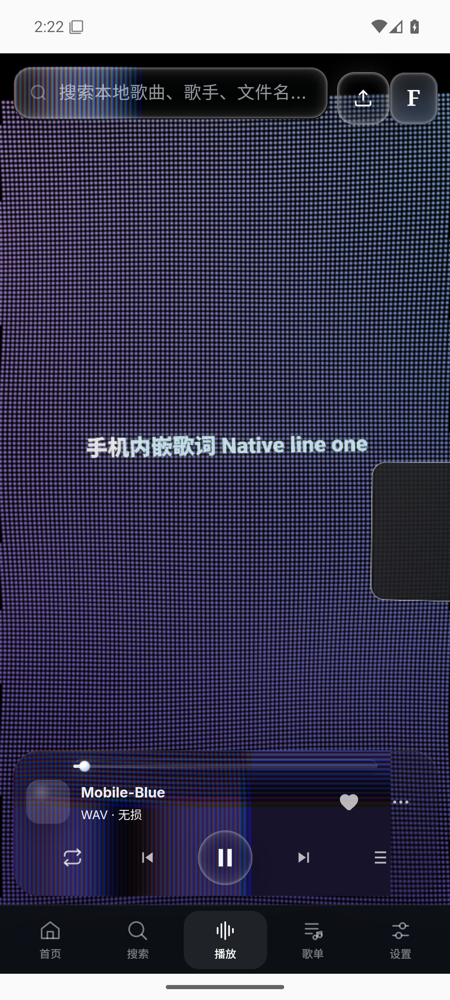
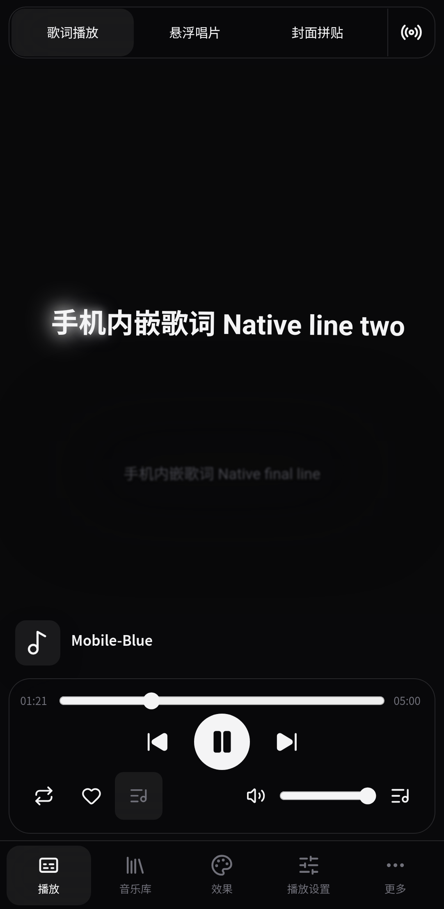

# Android 1.0.5 Folia 手机柔和隐藏动画已发布

更新：2026-11-07。Folia 手机界面沿用 1.0.4 的闲置自动隐藏，1.0.5 将隐藏与唤回改为柔和过渡，减少突然消失和画面跳变。控制区以 520ms 淡入淡出并轻移 8px，舞台中心以 560ms 平移衔接；使用 cubic-bezier(.4,0,.2,1) 缓起缓收，不拉伸文字，也不逐帧重分配舞台尺寸。唤回时背景保持满尺寸，舞台移动完成后再恢复显示状态的尺寸。resize／destroy 清理动画状态，减少动态效果偏好下跳过动画。闲置约 2.5 秒后隐藏顶部导航、歌曲信息、播放控件和底部导航，歌词、悬浮唱片或封面舞台铺满界面。首次轻触只唤回控件，不触发下面的播放、跳转或切歌；可见控件正常响应下一次操作。进度和音量长拖期间保持可见，pointerup／pointercancel 后重新计时；曲库、设置、更多及歌单菜单打开时保持可见，关闭后恢复计时。 原生音频沿用 1.0.3 的单一 PCM 引擎和 AudioTrack；本次隐藏与唤回只控制 Folia 界面，播放、既有音效和后台连续性继续走原链路。 Android 云端发行、公开 APK 完整回下载及最终版本与签名核验已完成；以下 1.0.4 和更早记录完整保留。

## 下载与源码

- [Android 1.0.5 APK](https://github.com/oirge/Mineradio/releases/download/android-v1.0.5/Mineradio-Android-1.0.5.apk)，14,471,126 字节；[Release](https://github.com/oirge/Mineradio/releases/tag/android-v1.0.5)，Release ID `437397443`。
- 发布时间 `2026-11-07T06:51:11Z`（北京时间 2026-11-07 14:51:11）。tag `android-v1.0.5` → `6c0c551063184b4089c19d7639d72e526ad2243a`；versionName `1.0.5`、versionCode `10005`、应用 ID `com.mineradio.oirge.mobile`。
- APK SHA256：`52fb46c52debfe5395b6d3f129ba332b9d00eb335ff419af10eeea3e2321210d`。完整回下载、本地重算、SHA256SUMS、GitHub digest 和同一 run 的签名 release 构建产物一致；公开下载、manifest、v2 签名与原证书均已核验。
- 证书 SHA256：`ee1586586ac8d13b17dda8020eda86712d62bac7b96e3f3b5e8643151faff0a6`，支持覆盖旧版更新。旧版资产保留，桌面 Latest 仍为 `v2.6.10`。
- 分支 `codex/android-mobile`，[PR #178](https://github.com/oirge/Mineradio/pull/178)；发行 tag 固定上述提交，后续文档提交不重打 tag 或替换已发布资产。

## 实现与云端验收

- Folia 手机界面沿用 1.0.4 的闲置自动隐藏，1.0.5 将隐藏与唤回改为柔和过渡，减少突然消失和画面跳变。控制区以 520ms 淡入淡出并轻移 8px，舞台中心以 560ms 平移衔接；使用 cubic-bezier(.4,0,.2,1) 缓起缓收，不拉伸文字，也不逐帧重分配舞台尺寸。唤回时背景保持满尺寸，舞台移动完成后再恢复显示状态的尺寸。resize／destroy 清理动画状态，减少动态效果偏好下跳过动画。闲置约 2.5 秒后隐藏顶部导航、歌曲信息、播放控件和底部导航，歌词、悬浮唱片或封面舞台铺满界面。首次轻触只唤回控件，不触发下面的播放、跳转或切歌；可见控件正常响应下一次操作。进度和音量长拖期间保持可见，pointerup／pointercancel 后重新计时；曲库、设置、更多及歌单菜单打开时保持可见，关闭后恢复计时。
- 原生音频沿用 1.0.3 的单一 PCM 引擎和 AudioTrack；本次隐藏与唤回只控制 Folia 界面，播放、既有音效和后台连续性继续走原链路。
- [Android 发行验收 42347431269](https://github.com/oirge/Mineradio/actions/runs/42347431269)：build、browser、native、publish 成功；最终 attempt `2`。Node 1692 项通过，手机浏览器 11 项、Android 原生 14 项和 DSP 原语 8 项通过。
- 证据工件：build `13564725129`、native `13564562963`、browser `13564371541`，均由公开安装包验收脚本核实来自固定发行 SHA／run。
- 浏览器真实触摸覆盖闲置隐藏、唤回不穿透、进度与音量长拖、up／cancel 后重新隐藏、曲库／设置／更多与歌单菜单保护，以及手机横竖屏和返回桌面布局。
- 浏览器保存完整闲置隐藏、轻触唤回及单次反向尝试的动画样本与原始事件。浏览器单次真实触摸在隐藏动画中途到达，已验证从当前位置反向回到显示位置。
- 手机浏览器验收使用云端 Xvfb 虚拟显示器中的 Chromium 与 SwiftShader，保留正常动画时钟、真实触摸和原 2 秒唤回期限；不禁用或快进动画，不在唤回检查中请求截图来推动动画。本次云端 rAF 回调最大间隔约 549.9ms，未验收稳定 60fps 或实际手机帧率。
- Android WebView 的真实触摸及 DOM 状态记录覆盖隐藏与唤回；隐藏前、隐藏后、唤回后的原生进度为 `118.704` → `121.243` → `129.131` 秒；保持 AudioTrack session `153`、sinkCreations `1`、同曲目 generation 和欠载计数 `0`，输出帧与播放头持续推进。隐藏舞台为 `412.19 × 842.286`，覆盖 `412 × 842` 的手机视口。 最终浏览器截图：隐藏图中顶部导航、歌曲信息、播放控件和底部导航均已消失，歌词舞台铺满视口；恢复图中四组控件正常显示，舞台回到原布局；最终 Android 系统截图：原始系统隐藏截图仍显示四组控件及原舞台布局，与同轮 DOM 隐藏和满舞台记录不一致；恢复截图四组控件正常显示。渲染或截图原因未确认，实际手机显示效果未验收。
- 原生回归继续覆盖既有 PCM 音效、内嵌歌词、锁屏、移除任务、媒体控制、快速返回、界面重建和冷恢复；本次没有修改原生引擎。
- [Verify video export 42347435775](https://github.com/oirge/Mineradio/actions/runs/42347435775)：成功；该独立检查全部成功。
- [Verify 42347435774](https://github.com/oirge/Mineradio/actions/runs/42347435774)：成功；该独立检查全部成功。
- [Verify 42347431302](https://github.com/oirge/Mineradio/actions/runs/42347431302)：成功；该独立检查全部成功。
- 独立 CI 结果以上述最终运行记录为准。

## 完整证据与边界

- [完整发行核验](android-evidence/1.0.5-verification.json)、[原生 14 项报告](android-evidence/1.0.5-native.json)、[完整原生状态序列](android-evidence/1.0.5-background.json)、[手机浏览器 11 项报告](android-evidence/1.0.5-browser.json)、[DSP 8 项原语报告](android-evidence/1.0.5-dsp.json)、[完整 Folia 隐藏与唤回状态](android-evidence/1.0.5-chrome.json)、[完整动画样本与触摸事件](android-evidence/1.0.5-animation.json)。七份文件保留完整原始 JSON，包含三阶段 UI、四组控件的样式／边界、原生状态及所有动画 samples／events／interruption。
- 功能、Folia 交互和连续播放取证使用同一发行提交的 debug APK；签名 release APK 在同一云端 run 另验安装及离线导入首页启动，未在 release 包上重复整套播放取证。云端模拟器使用 `-noaudio`，依据真实 PCM、AudioTrack 播放头和欠载计数，未做扬声器听感验收。最终浏览器截图：隐藏图中顶部导航、歌曲信息、播放控件和底部导航均已消失，歌词舞台铺满视口；恢复图中四组控件正常显示，舞台回到原布局；最终 Android 系统截图：原始系统隐藏截图仍显示四组控件及原舞台布局，与同轮 DOM 隐藏和满舞台记录不一致；恢复截图四组控件正常显示。渲染或截图原因未确认，实际手机显示效果未验收。1.0.4 系统隐藏截图与 DOM 状态不一致的历史记录完整保留；此前软件 GPU 也出现过色块、条纹与合成异常。实际手机显示效果仍未验收。Android 7.0 及以上，平台解码器、品牌省电策略与实际用户覆盖安装数据组合仍需更多设备覆盖；系统「强行停止」会结束播放。桌面在线翻译与视频导出尚未接入 Android，桌面 Latest 独立。
- 本机未启动 GUI／浏览器／模拟器／构建或测试，未安装本次 APK 或操作用户播放器与数据，未发邮件。

# Android 1.0.4 Folia 手机自动隐藏已发布

更新：2026-11-07。Folia 手机界面原先一直显示控制层，现在闲置约 2.5 秒后同时隐藏顶部导航、歌曲信息、播放控件和底部导航，歌词、悬浮唱片或封面舞台铺满界面。首次轻触只唤回控件，不触发下面的播放、跳转或切歌；可见控件正常响应下一次操作。进度和音量长拖期间保持可见，pointerup／pointercancel 后重新计时；曲库、设置、更多及歌单菜单打开时保持可见，关闭后恢复计时。 原生音频沿用 1.0.3 的单一 PCM 引擎和 AudioTrack；本次隐藏与唤回只控制 Folia 界面，播放、既有音效和后台连续性继续走原链路。 Android 云端发行、公开 APK 完整回下载及最终版本与签名核验已完成；以下 1.0.3 和更早记录完整保留。

## 下载与源码

- [Android 1.0.4 APK](https://github.com/oirge/Mineradio/releases/download/android-v1.0.4/Mineradio-Android-1.0.4.apk)，14,469,958 字节；[Release](https://github.com/oirge/Mineradio/releases/tag/android-v1.0.4)，Release ID `437338499`。
- 发布时间 `2026-11-07T04:43:39Z`（北京时间 2026-11-07 12:43:39）。tag `android-v1.0.4` → `79a57813a75a0184b98d9b7195c78efc002e5b6a`；versionName `1.0.4`、versionCode `10004`、应用 ID `com.mineradio.oirge.mobile`。
- APK SHA256：`296d7094f1a639df0e8b3e300a33a7b144203aad5a9eeada21b5ef3a09d70647`。完整回下载、本地重算、SHA256SUMS、GitHub digest 和同一 run 的签名 release 构建产物一致；公开下载、manifest、v2 签名与原证书均已核验。
- 证书 SHA256：`ee1586586ac8d13b17dda8020eda86712d62bac7b96e3f3b5e8643151faff0a6`，支持覆盖旧版更新。旧版资产保留，桌面 Latest 仍为 `v2.6.10`。
- 分支 `codex/android-mobile`，[PR #178](https://github.com/oirge/Mineradio/pull/178)；发行 tag 固定上述提交，后续文档提交不重打 tag 或替换已发布资产。

## 实现与云端验收

- Folia 手机界面原先一直显示控制层，现在闲置约 2.5 秒后同时隐藏顶部导航、歌曲信息、播放控件和底部导航，歌词、悬浮唱片或封面舞台铺满界面。首次轻触只唤回控件，不触发下面的播放、跳转或切歌；可见控件正常响应下一次操作。进度和音量长拖期间保持可见，pointerup／pointercancel 后重新计时；曲库、设置、更多及歌单菜单打开时保持可见，关闭后恢复计时。
- 原生音频沿用 1.0.3 的单一 PCM 引擎和 AudioTrack；本次隐藏与唤回只控制 Folia 界面，播放、既有音效和后台连续性继续走原链路。
- [Android 发行验收 42338308259](https://github.com/oirge/Mineradio/actions/runs/42338308259)：build、browser、native、publish 成功；最终 attempt `2`。Node 1692 项通过，手机浏览器 11 项、Android 原生 14 项和 DSP 原语 8 项通过。
- 证据工件：build `13560124176`、native `13561226414`、browser `13560099996`，均由公开安装包验收脚本核实来自固定发行 SHA／run。
- 浏览器真实触摸覆盖闲置隐藏、唤回不穿透、进度与音量长拖、up／cancel 后重新隐藏、曲库／设置／更多与歌单菜单保护，以及手机横竖屏和返回桌面布局。
- Android WebView 的真实触摸及 DOM 状态记录覆盖隐藏与唤回；隐藏前、隐藏后、唤回后的原生进度为 `141.054` → `143.729` → `152.070` 秒；保持 AudioTrack session `129`、sinkCreations `1`、同曲目 generation 和欠载计数 `0`，输出帧与播放头持续推进。隐藏舞台为 `412.19 × 842.286`，覆盖 `412 × 842` 的手机视口。 系统截图存在上述视觉不一致，不能声称其已肉眼证明隐藏。
- 原生回归继续覆盖既有 PCM 音效、内嵌歌词、锁屏、移除任务、媒体控制、快速返回、界面重建和冷恢复；本次没有修改原生引擎。
- [Verify video export 42338312860](https://github.com/oirge/Mineradio/actions/runs/42338312860)：成功；该独立检查全部成功。
- [Verify 42338312829](https://github.com/oirge/Mineradio/actions/runs/42338312829)：失败；Windows PR attempt 1：verify-ui-language.py 第74行等待 setUiLanguage 函数与 fx-panel-tabs 初始化超过30000ms；checks=[]、audits={}、errors=[]，语言检查尚未开始。此前 Folia 播放/显示选项与命令/音频工具检查已完成。精确日志：windows-pr-1.0.4-79a57813-attempt1.log。。
- [Verify 42338308217](https://github.com/oirge/Mineradio/actions/runs/42338308217)：成功；该独立检查全部成功。
- 独立 CI 仍有未成功记录，Android 发行门禁成功不代表全部 CI 成功。

## 完整证据与边界

- [完整发行核验](android-evidence/1.0.4-verification.json)、[原生 14 项报告](android-evidence/1.0.4-native.json)、[完整原生状态序列](android-evidence/1.0.4-background.json)、[手机浏览器 11 项报告](android-evidence/1.0.4-browser.json)、[DSP 8 项原语报告](android-evidence/1.0.4-dsp.json)、[完整 Folia 隐藏与唤回状态](android-evidence/1.0.4-chrome.json)。六份文件保留完整原始 JSON，包含三阶段 UI、四组控件的样式／边界及原生状态。
- 功能、Folia 交互和连续播放取证使用同一发行提交的 debug APK；签名 release APK 在同一云端 run 另验安装及离线导入首页启动，未在 release 包上重复整套播放取证。云端模拟器使用 `-noaudio`，依据真实 PCM、AudioTrack 播放头和欠载计数，未做扬声器听感验收。最终浏览器隐藏／恢复截图正确；但本次原生系统隐藏截图仍显示四组控件，与对应 DOM 的 opacity 0、visibility hidden 及满视口舞台记录不一致，系统图不能作为 Android 画面已成功隐藏的视觉证明，渲染或截图原因尚未确认。此前软件 GPU 也出现过色块、条纹与合成异常；实际手机显示效果仍未验收。Android 7.0 及以上，平台解码器、品牌省电策略与实际用户覆盖安装数据组合仍需更多设备覆盖；系统「强行停止」会结束播放。桌面在线翻译与视频导出尚未接入 Android，桌面 Latest 独立。
- 本机未启动 GUI／浏览器／模拟器／构建或测试，未安装本次 APK 或操作用户播放器与数据，未发邮件。

# Android 1.0.3 单一音频引擎已发布

更新：2026-11-07。用户要求修复进出界面的播放停顿、统一一套原生引擎并保留全部既有音效，现已完成实现、Android 云端发行验收、发布和完整安装包回下载核验。以下旧版记录按历史保留；双引擎及后台音效限制仅描述旧版本。

## 下载与源码

- [Android 1.0.3 APK](https://github.com/oirge/Mineradio/releases/download/android-v1.0.3/Mineradio-Android-1.0.3.apk)，14,467,916 字节；[Release](https://github.com/oirge/Mineradio/releases/tag/android-v1.0.3)，Release ID `437247750`。
- 发布时间 `2026-11-07T01:45:43Z`（北京时间 2026-11-07 09:45:43）。
- tag `android-v1.0.3` 指向 `8b82e28029a22e46c530fa9a7a61987adf7c169a`；versionName `1.0.3`、versionCode `10003`、应用 ID `com.mineradio.oirge.mobile`。
- APK SHA256：`f8897c987530956399fa2838ac5deaec6978a9154b7eacd245a74168b02c8ff2`。完整回下载、本地重算、SHA256SUMS、GitHub digest 与同一 run 的签名 release 构建产物一致，版本、v2 签名、原证书和公开下载均已核验。
- 签名证书 SHA256：`ee1586586ac8d13b17dda8020eda86712d62bac7b96e3f3b5e8643151faff0a6`，支持覆盖旧版更新。旧版资产保留，桌面 Latest 仍为 `v2.6.10`。
- 分支 `codex/android-mobile`，[PR #178](https://github.com/oirge/Mineradio/pull/178)；发行 tag 与后续文档提交区分，不重打 tag 或替换已发布资产。

## 实现与验收

- 音乐始终由前台媒体服务中的同一套 PCM 引擎和 AudioTrack 输出；切后台、锁屏、移除最近任务及重新打开界面只同步状态。原生链路保留 10 段 EQ、自动／手动预增益、限幅、立体声宽度、ReplayGain 及防削波、保持音高的倍速、无缝接续和交叉淡入淡出。歌单选择提示音混入同一输出，Mineradio 与 Folia 共享真实 PCM 频谱、时域分析、播放状态和内嵌歌词。
- [Android 发行验收 42324115244](https://github.com/oirge/Mineradio/actions/runs/42324115244)：build、browser、native、publish 成功；Node 1692 项通过，手机浏览器 10 项、Android 原生 13 项及 DSP 原语 8 项通过。
- 最终 Android attempt `2` 成功；同 SHA 的 attempt 1 在首次首页截图时 CDP target 关闭，未开始播放取证。保留该次失败，不将历史全部运行写成成功。证据工件：build `13554856354`、native `13554719126`、browser `13554083082`，均来自同一发行 SHA／run。
- 锁屏后实际进度由 `105.648` 秒推进至 `126.955` 秒，返回界面为 `129.244` 秒；同一 AudioTrack session `145`，sinkCreations 为 `1`，这些阶段欠载计数保持 `0`，三次快速返回同样通过连续性门禁。
- 倍速实测 `1.51036x`；交叉淡入淡出累计 `143664` 混音帧，交叉计数 `1`；活动证据包含 `5120` 已写入并由播放头消费的混音帧，同 session／sink／generation 校验通过。
- 移除真实最近任务后独立续播、自然下一首、媒体键暂停／继续／切歌、播放与暂停时重建界面、关闭自动播放后的冷恢复、真实 SAF 文件导入和内嵌歌词均有完整原生状态与检查报告。
- [Verify video export 42324128075](https://github.com/oirge/Mineradio/actions/runs/42324128075)：成功；该独立检查全部成功。
- [Verify 42324124181](https://github.com/oirge/Mineradio/actions/runs/42324124181)：成功；该独立检查全部成功。
- [Verify 42324115217](https://github.com/oirge/Mineradio/actions/runs/42324115217)：成功；该独立检查全部成功。
- 独立 CI 结果以上述最终运行记录为准。

## 证据与边界

- [完整发行核验](android-evidence/1.0.3-verification.json)、[原生 13 项报告](android-evidence/1.0.3-native.json)、[完整原生状态序列](android-evidence/1.0.3-background.json)、[手机浏览器 10 项报告](android-evidence/1.0.3-browser.json)、[DSP 8 项原语报告](android-evidence/1.0.3-dsp.json)。这些文件保留完整原始 JSON。
- Android 7.0 及以上，格式支持取决于 Android 平台解码器；品牌省电策略与实际用户覆盖安装数据组合仍需更多设备覆盖。系统「强行停止」会结束播放。原生限幅保留全部控制参数，但不保证与 WebAudio 逐样本一致；交叉期间 ReplayGain 沿用既有公共增益语义，未实现独立每曲增益包络。功能取证使用同提交 debug 包，签名 release 包另行完成安装与离线导入首页启动核验。云端模拟器使用 `-noaudio`，结论来自实际 PCM、AudioTrack 播放头和欠载计数，未做扬声器听感验收。部分软件 GPU 截图存在色块、条纹与内容合成异常，交互检查通过不代表全部视觉渲染已验收。桌面在线翻译与视频导出尚未接入 Android，桌面 Latest 独立。
- 本机未启动 GUI／浏览器／模拟器／构建或测试，未安装本次 APK 或操作用户播放器与数据，未发邮件。

# Android 1.0.2 后台播放已发布

更新：2026-11-06。用户要求「让能后台播放音乐」，现已完成实现、云端验收、发布和完整安装包回下载核验。下方 1.0.1 记录作为历史保留。

## 下载与源码

- [Android 1.0.2 APK](https://github.com/oirge/Mineradio/releases/download/android-v1.0.2/Mineradio-Android-1.0.2.apk)，14,445,214 字节；[Release](https://github.com/oirge/Mineradio/releases/tag/android-v1.0.2)，Release ID `436096715`。
- 发布时间 `2026-11-06T04:22:52Z`（北京时间 2026-11-06 12:22:52）。
- tag `android-v1.0.2` 指向 `a79e7681fe3083111bd07f892881cb07d17554b6`；versionName `1.0.2`、versionCode `10002`、应用 ID `com.mineradio.oirge.mobile`。
- APK SHA256：`dc189cf5e0d96eb6df766283cbda439e3445d6de93157b4cce21acf6dfef580f`。完整回下载、本地重算、SHA256SUMS、GitHub digest 与云端验收包清单一致，公开下载 HEAD 200。
- 签名 v2 通过，证书沿用 1.0.0／1.0.1：`ee1586586ac8d13b17dda8020eda86712d62bac7b96e3f3b5e8643151faff0a6`，支持覆盖更新。旧版资产未替换，桌面 Latest 仍为 `v2.6.10`。
- 分支 `codex/android-mobile`，[PR #178](https://github.com/oirge/Mineradio/pull/178) 保持打开；最终文档提交与发行 tag 区分，不能重打 tag 或覆盖已发布资产。

## 实现

- 原服务只维持媒体通知，声音依赖 Activity 内的 WebAudio，移除最近任务时会暂停。新增服务内独立的 `NativeBackgroundPlayer`，使用平台 MediaPlayer 维护 SAF 授权队列、播放位置、音量／倍速、音频焦点、耳机断开、唤醒锁、睡眠计时和自然续播。
- 串行交接：先暂停网页 deck 并挂起 AudioContext，再启动原生输出；返回时先释放原生播放器，再恢复当前歌曲、位置和播放／暂停状态。服务不随最近任务移除停止，支持媒体控制和状态持久化。
- 修复验收发现的切歌问题：保存下一首快照前先释放旧 MediaPlayer，避免旧曲尾位置污染新曲起点。自然切歌和媒体键下一首都必须从新歌开头播放，未放宽暂停／继续的进度断言。
- 保留 1.0.1 的内嵌歌词及 Folia 修复，未修改 Folia 源码，无新增 Maven 依赖。

## 云端验收

- [Android 发行验收 42160875686](https://github.com/oirge/Mineradio/actions/runs/42160875686)：build、browser、native、publish 全成功。Node 1676 通过／0 失败／1 可选跳过，手机浏览器 10 项，Android 15 / API 35 原生 11 项；原生 `errors=[]`、`systemDialogs=[]`。
- [完整 Windows Verify 42160882111](https://github.com/oirge/Mineradio/actions/runs/42160882111)、[push Verify 42160875643](https://github.com/oirge/Mineradio/actions/runs/42160875643) 与[实际视频导出 42160882023](https://github.com/oirge/Mineradio/actions/runs/42160882023) 均成功。
- Home 后网页 `audio.paused` 且 AudioContext suspended，原生 audioSessionId 有效；屏幕实际进入 Dozing，原生进度从 `97.584` 秒增至 `118.365` 秒，返回前台接回位置且没有重复输出。
- 精确找到并移除真实最近任务后，原生从 `880.695` 秒继续，到曲尾后独立切换下一首，并从 `1.894` 秒开始播放。无 Activity 时媒体键暂停停在 `2.286` 秒，等待期间不变，继续后到 `4.315` 秒；媒体键下一首从 `1.920` 秒播放。
- 重建 Activity 恢复正在播放的正确歌曲与位置；再次后台暂停后回到前台仍暂停且位置匹配；强制停止后的 SAF 授权、曲库、内嵌歌词恢复和精确签名发行包安装启动通过。
- 已人工查看主舞台、Folia 和冷恢复系统截图，内嵌歌词可见。命名为 `android-background-notification.png` 的截图实际捕获了桌面，不能作为通知面板视觉验收；媒体控制以系统媒体键和真实服务状态为证。

## 证据与边界

- [完整发行核验](android-evidence/1.0.2-verification.json)、[原生 11 项报告](android-evidence/1.0.2-native.json)、[原生后台状态序列](android-evidence/1.0.2-background.json)、[手机浏览器 10 项报告](android-evidence/1.0.2-browser.json)。
- 云端原生 artifact `13476708625`、浏览器 artifact `13477067466`、精确签名包 artifact `13476174782`。本机 `output/cloud/native-1.0.2-accepted`、`browser-1.0.2-accepted`、`published-1.0.2` 保留报告、截图与安装包；核验脚本固定发行 SHA／run。
- 后台暂不执行 WebAudio 音效、ReplayGain 和交叉淡入淡出；前台恢复原设置。后台格式取决于 Android 系统播放器；系统「强行停止」会结束播放。
- Android 预览版尚未覆盖所有品牌、省电策略和实际用户覆盖安装数据组合。此需求没有剩余必做项；品牌设备覆盖、通知面板视觉补验与 PR 合并可后续单独处理。
- 继续遵守云端优先，不在本机启动 GUI／浏览器／模拟器／构建或测试，不操作用户播放器／数据，不发邮件，不创建子代理。

# Android 1.0.1 发布与验收记录

更新：2026-11-06。内嵌歌词读取与 Folia 无歌词问题已修复，Android 1.0.1 已发布并完成完整安装包核验。

## 下载与源码

- [下载 APK](https://github.com/oirge/Mineradio/releases/download/android-v1.0.1/Mineradio-Android-1.0.1.apk)，14,432,708 字节；[Release](https://github.com/oirge/Mineradio/releases/tag/android-v1.0.1)，Release ID `436020179`。
- 发布时间 `2026-11-06T02:09:37Z`（北京时间 2026-11-06 10:09:37）。
- tag `android-v1.0.1` 指向 `6cf8a91a8d063a46fd7f8f96a2571ddaa77e295f`；versionName `1.0.1`、versionCode `10001`、应用 ID `com.mineradio.oirge.mobile`。
- 沿用 1.0.0 证书，可覆盖安装；未在用户电脑安装或操作用户播放器／数据。
- APK SHA256：`cecccd73db75a7f9a93dcd4de08075fb4af39cd28e3632d82d6aed7933561fb6`。完整回下载与 SHA256SUMS、GitHub asset digest 三方一致，公开下载 HEAD 200。
- 签名 v2 通过，证书 SHA256：`ee1586586ac8d13b17dda8020eda86712d62bac7b96e3f3b5e8643151faff0a6`。桌面 Latest 仍为 `v2.6.10`。
- 分支 `codex/android-mobile`，[PR #178](https://github.com/oirge/Mineradio/pull/178) 保持打开。

## 修复

- Capacitor 8.6.0 的 `PluginCall.getLong()` 不接受常见 JSON Integer，读取偏移回落为 0；原生改用 `getData().optLong()`，保留 SAF 授权校验。
- JS 每次 1 MiB 桥接读取并聚合完整标签范围，总上限 64 MiB；失败不会成为成功空结果。
- reader 版本签名同时使旧资产、歌词和曲库索引负缓存重新识别；歌曲 key 不变。新增 7 项生产函数回归。
- 普通舞台与 Folia 读取同一歌词数据，未修改 Folia 源码。

## 云端验收

- [Android 发行验收 42147297303](https://github.com/oirge/Mineradio/actions/runs/42147297303)：build、browser、native、publish 全成功。Node 1667 通过／0 失败／1 可选跳过，浏览器 10 项，Android 原生 9 项。
- 真实 ID3v2.4 USLT 内嵌歌词经 SAF 导入、非零范围读取、主引擎解析及 Folia 当前句可见性通过；后台播放、冷启动授权／曲库与内嵌歌词恢复、精确签名发行包安装启动通过。
- 原生报告 `errors=[]`；系统 Pixel Launcher ANR 有一次精确、有限处理并留存证据。
- [完整 Windows Verify 42147367912](https://github.com/oirge/Mineradio/actions/runs/42147367912) 成功，昨天的截图超时本轮未复现。
- [系统屏幕复核 42149065288](https://github.com/oirge/Mineradio/actions/runs/42149065288) 成功，publish 按 `publish_release=false` 跳过，没有替换已发布资产。提交 `7be0c8bf91c45fcdb1b42692c2912b0277f911ee` 仅修改工作流与验收脚本，应用代码与发行源码相同。
- 网页 CDP 截图未包含主舞台 WebGL，ADB 系统截图确认实际歌词可见；后续验收保留两种截图，不能用 CDP 黑图直接判定 WebGL 未显示。

## 实际截图

普通舞台系统截图：

Folia 显示同一音乐的内嵌歌词：

## 证据与后续

- 发行原生 artifact `13471455791`、手机浏览器 artifact `13470439465`；系统屏幕复核 artifact `13472510510`。
- 本机证据：`output/cloud/native-1.0.1-accepted`、`browser-1.0.1-accepted`、`native-1.0.1-physical`；发行包 `output/cloud/published-1.0.1/`。
- 完整发行核验报告：`output/cloud/published-1.0.1-verification.json`；复查脚本 `output/cloud/verify-published-1.0.1.py` 固定发行 SHA／run，不要改成文档提交或补充截图提交。
- Android 预览版，尚未覆盖全部品牌手机与系统省电策略，解码依赖设备 WebView；没有宣称实际覆盖安装后的所有用户数据组合均已实测。
- 此次需求已完成。后续合并 PR 或扩展品牌设备支持另行处理；不要重复发布或覆盖 1.0.0／1.0.1 资产。
- 2026-11-05 暂停记录和历史失败保留在 Git 历史，可查看文档提交 `6cf8a91a8d063a46fd7f8f96a2571ddaa77e295f`。

继续遵守云端优先、不启动本机 GUI／浏览器／模拟器／构建、不操作用户播放器数据、不发邮件、不创建子代理。
